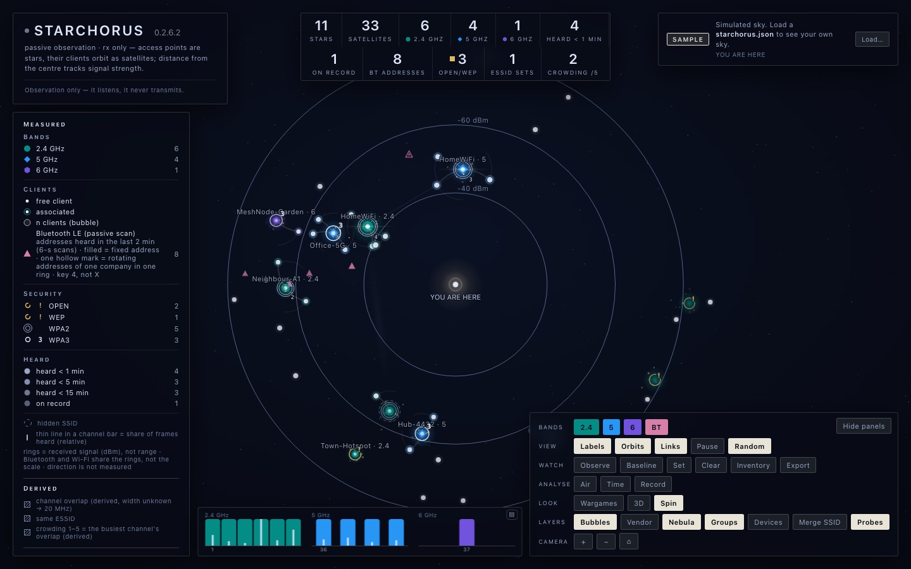
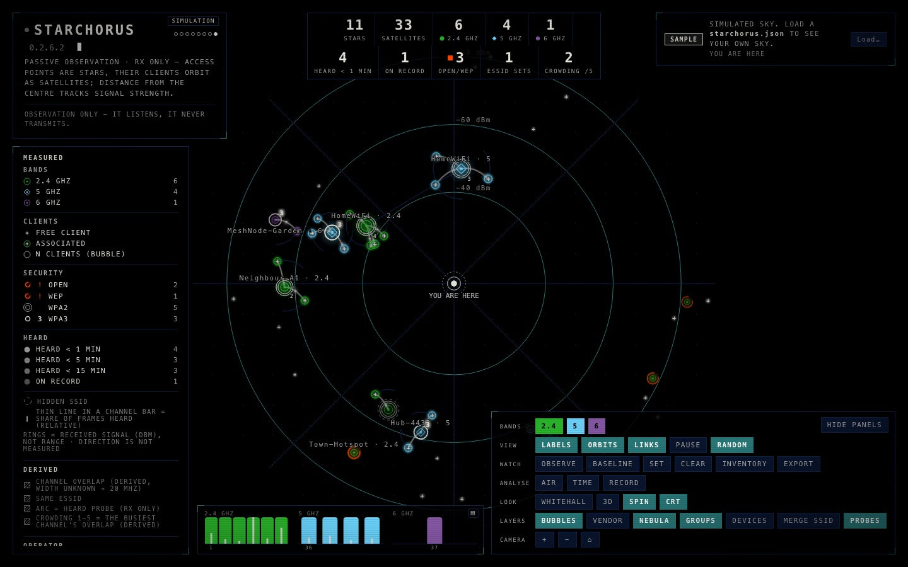
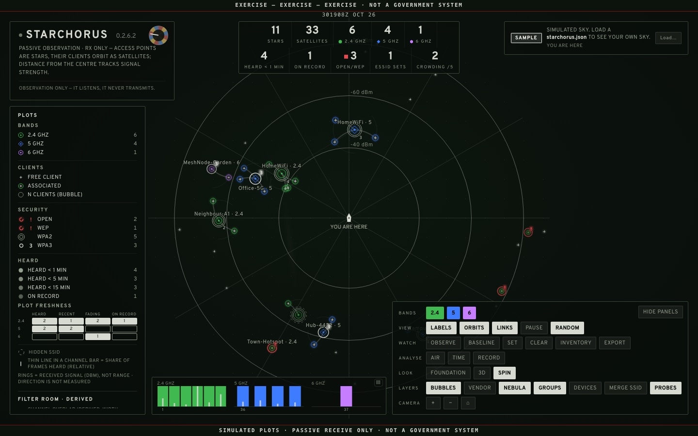
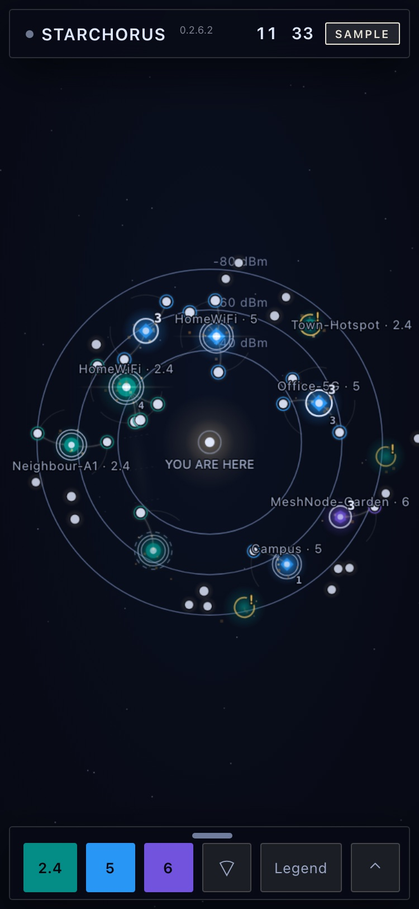

# Starchorus

**A strictly passive, receive-only monitor: it listens and never transmits.** Starchorus shows the Wi-Fi around a device as
a night sky: a shell script on the device listens, and a single HTML page draws the sky from what it
hears.

Starchorus is written for the **Hak5 WiFi Pineapple Pager**, and 'the device' throughout this
repository means the Pager. It is an independent project, not affiliated with, sponsored or endorsed
by Hak5; see [Trademarks](#trademarks).

[](https://github.com/starchorus/pager/actions/workflows/quick.yml)
[](LICENSE)
[](https://github.com/starchorus/pager/releases)

[Quick start](#quick-start) · [Installation](INSTALL.md) · [Payload](#payload) · [Passivity](#passivity-as-a-design-guarantee) ·
[Configuration](#configuration) · [Licence](#licence) · [Contributing](CONTRIBUTING.md) ·
[Security](SECURITY.md) · [Code of Conduct](CODE_OF_CONDUCT.md)

[](docs/img/starchorus-foundation.jpg)

<table>
  <tr>
    <td align="center" width="33%"><a href="docs/img/starchorus-foundation.jpg"></a><br><sub><b>Foundation</b> (default)</sub></td>
    <td align="center" width="33%"><a href="docs/img/starchorus-wargames.jpg"></a><br><sub><b>WarGames</b></sub></td>
    <td align="center" width="33%"><a href="docs/img/starchorus-whitehall.jpg"></a><br><sub><b>Whitehall</b></sub></td>
  </tr>
</table>

<sub>All images show the built-in demo mode: simulated sample data with placeholder names, not a real environment. `T` switches between the themes.</sub>

<p align="center"></p>

<sub>On a phone the sky has the whole screen and the controls live in a sheet you pull up when you want them.</sub>

## Overview

The device sits in the centre, each access point is a star, and its clients orbit it as satellites.
Signal strength sets the orbit radius (stronger = closer to the centre), the colour stands for the
band (2.4/5/6 GHz), and a fine ring for the encryption.

- **Collector.** `starchorus-collect.sh`, a POSIX shell script on the device, reads the device's
  recon database (from a read-only copy) or listens in monitor mode, and writes `starchorus.json`.
- **Page.** `starchorus.html` is one self-contained page without external resources. It reads
  `starchorus.json` in step with the collector's cycle. The Pager's display is too small for a sky, so the page is
  meant for a second screen: a laptop, tablet or phone on the Pager's USB-C or management Wi-Fi
  opens `http://172.16.52.1:8199/`, with nothing to install. On a phone it has a layout of its own.
- **On-device Overview.** `starchorus-display.sh` shows the same data, as counts and lists, on the
  device's own display, for a glance when no second screen is to hand.
- **Payload.** On the device, the payload in `library/user/reconnaissance/starchorus/` starts the
  collector, the page server (port 8199) and the Overview, and shows the page's address as a QR code.
- **In your browser.** The demonstration runs at <https://starchorus.com/pager/>, nothing to install.
- **Without hardware.** Run `python3 -m http.server --bind 127.0.0.1 8000` in this folder and open
  `http://127.0.0.1:8000/`; with no data file, the page runs a built-in demo.

Starchorus never transmits. The one exception, an active scan, needs an explicit opt-in
(`STARCHORUS_ALLOW_ACTIVE=1`) and is off by default. The code is under GPL-3.0-or-later; the
embedded font is under the SIL OFL 1.1 (see [Licence](#licence)).

## Why a sky

A Wi-Fi survey usually arrives as a table: dozens of rows of BSSIDs, channels and dBm figures,
accurate and very nearly unreadable. Starchorus draws the same facts as a sky. Which networks
dominate, which channels are crowded, which devices are asking after networks, and how all of it
changes over a few minutes can be taken in at a glance rather than worked out line by line.

That makes it useful beyond the person holding the Pager: for teaching how Wi-Fi actually behaves,
for explaining a site survey to someone who does not read dBm, and for putting on a screen what is
otherwise invisible. The built-in demo, with simulated data and placeholder names, is suitable for
on-set playback and screen graphics in film and television as it stands: it looks the part and
discloses nothing about anyone. If Starchorus appears on screen, a credit is appreciated, though
the licence does not require one.

## Version

Starchorus 0.2.5. Every part carries the same number:

| Part | File | Version |
|---|---|---|
| Page | `starchorus.html` | 0.2.5 |
| Collector | `starchorus-collect.sh` | 0.2.5 |
| On-device Overview | `starchorus-display.sh` | 0.2.5 |
| Payload | `library/user/reconnaissance/starchorus/payload.sh` | 0.2.5 |

## What the page shows

- **The turning sky.** The whole sky turns slowly about the device, one revolution in five minutes
  (key `S`, on by default). The rotation is rigid: every distance from the centre (= signal strength)
  and every distance between two nodes stays exact. Pause and Reduced Motion hold the sky still;
  `?spin=0` switches the rotation off.
- **Rings at −40/−60/−80 dBm** mark the received signal level, not distance. Direction is not
  measured.
- **Freshness.** Star, ring and station dot dim with age (`generated − last_seen`): under 1 min,
  under 5 min, under 15 min, only in the record, undated.
- **Derived views**, each display only and without new JSON fields:
  - Device links (`D`) group BSSIDs that probably belong to one physical device.
  - Merge SSID (`M`) folds a roaming network into one node.
  - Probe orbits (`P`) let a client circle, dashed, around the visible network it is looking for.
    The orbit is inferred, not an association.
  - Random clouds: a phone or laptop that scans with a fresh randomised address each time leaves a
    trail of short-lived addresses. Free randomised addresses heard in one signal band, in bursts
    that recur at a steady period standing clear of what unrelated bursts in that band would give
    by chance, are drawn as one cloud with its count ('121 · random'); its detail gives the period
    ('about every 47 s') and lists the addresses. Two devices of different periods at one signal
    are two clouds, and a cloud whose bursts keep no one rhythm is mixed and reads 'possibly one or
    more nearby devices'. A cloud is an estimate from signal and timing, never a device count.
    Random (`X`, or `?random=cloud|show|hide`) cycles between clouds, the addresses one by one, and
    hidden; the legend still counts them all ('n randomised MAC · k in m clouds'). The Overview
    counts clouds by the same rule ('Clients 247 free (245 random, 1 cloud)'), and the CSV export
    ends in a `cloud` column.
- **Bluetooth LE** (opt-in, Settings > Bluetooth, or `STARCHORUS_BLUETOOTH=1`): a passive scan of 5 seconds per refresh. What it
  hears is drawn as small triangles at the radius of their signal on the same rings as the Wi-Fi nodes; the rings are shared, the scale is not,
  and direction is not measured. A filled triangle is an address that does not rotate, a hollow one is rotating addresses of one
  company in one signal ring, folded into one mark (a dot at its centre; the tooltip gives the count); the figures are **addresses, not
  devices**, and a rotating address is never linked to another. The company is the id in the advertisement (it names who registered the
  data, not necessarily the maker), shown by its name where the scan reports one. Key `4` and the 'BT' button hide the layer; the
  counter 'BT addresses' (it keeps its count while the marks are hidden, and reads a dash when a scan failed and nothing is held) and
  the legend say which window the figure covers. Without a valid scan this cycle the marks are kept for two minutes and dim by age. A
  mark has a tooltip, no detail sheet in this release.
- **Channel activity and traffic** (opt-in, Settings > Traffic, or `STARCHORUS_TRAFFIC=1`): the AP service's frame count per frequency
  becomes a thin whisker in each channel bar, a **relative share** of the frames heard, with its own scale and never a device count; the
  Bands screen of the Overview shows it as text bars. A station that is heard often wears four short ticks round its dot, in three
  levels on a logarithmic scale of the frames heard from it per second (the scale ends at 5 per second, about the 95th percentile
  measured on one device); it depends on where the radio listens, and it shows nothing when the feed is not live.
- **Alerts** (on by default, and silent until the file exists): the Pager's own alert engine can report that it heard many deauth/disassoc
  frames for an access point. A small companion alert payload, `alert-deauth.sh`, which the owner installs by hand (see Alerts, below),
  writes one line to `alerts.log` for each report, and the collector turns the lines of the last ten minutes into `alerts[]`. The page lists
  them as 'many deauth/disassoc frames heard for this AP: <name> (<n>)'. It is a hint and not a diagnosis: a report carries no channel, no
  signal strength and no count of frames, `n` counts reports, and the source address is whatever the frames claim.
- **Tools:** Observations (`W`), baseline diff (`B`), inventory (`I`), air quality (`Q`),
  signal over time (`J`), recording and replay (`H`), channel view (`Y`), homing meter (`F`).
  Export as JSON, CSV, SITREP text or PNG.
- **2D/3D** (`V`): a flat ring chart or a tilted orbit (height = band). The device always stays in
  the middle, and zoom centres on the device (in 2D from half size to four times). The Camera buttons
  `+`, `−` and reset are there in both views (not in 2D on a window 620 px high or less); the orbit arrows only in 3D.

The page is a single HTML file without external resources. Its only network call fetches
`starchorus.json` from the same directory: shortly before the next capture is due, then every 2
seconds until it arrives. It learns the spacing from the captures' own `generated` times (at first
from the interval the file announces); while no live capture is shown it asks every 5 seconds. It
starts with a simulation marked 'Sample' and switches the chip to 'Live' as soon as the file is
there. If no new capture arrives within twice the announced interval plus 15 seconds (at least
30 s; 30 s when the file announces none), the chip shows 'Stale'; if the Pager has not answered
the last three polls by then, because the phone has left its Wi-Fi, say, it shows 'Offline' instead. A fetch
that has not answered after 4 s is aborted and counts as failed. A `starchorus.json` can also be added with 'Load…' or
dropped onto the page.

On a phone – up to 720 px wide, or any phone on its side – the sky keeps the screen. Everything
else folds into a status bar (STARCHORUS, the counts, the chip) and a bottom sheet with three
heights: tap the chevron, drag or flick the sheet; a tap on the sky closes it. The sheet shows one
card at a time: the controls (with the channel bar, the counts, the source and Help), the legend,
a drawer, a network's detail or the keys. On its side the bar and the sheet form a column on the
left. `?phone=1` or `?phone=0` forces the choice. At any size, `U` or 'Hide panels' leaves the sky
alone with a small status pill that brings the panels back; the choice is remembered.

The sheet's row also has a 'Scope' button (key `Z`, or `?scope=1`), off until you turn it on and only on a
phone. It swaps the sky for a fan standing on the Pager: each band has a lane (2.4, 5 and 6 GHz, then
stations, then Bluetooth while any mark is heard), a network sits along its lane by channel, and the arcs are the received signal in dBm, so a
strong signal sits on the inner arcs, by the Pager's mark. Every new capture draws one arc contracting across the fan, and new
points appear as it passes; nothing sweeps and nothing is sent. When the feed goes stale or offline the fan
fills with snow and the chip's word. The lanes are bands and the arcs are signal: the Scope never shows
where a network is.

With a passive source, the masthead reads 'Observation only — it listens, it never transmits.'.
If the capture comes from the collector's active opt-in (`source: "iw-scan-ACTIVE"`), the page
replaces every statement of passivity with 'ACTIVE SCAN · the collector sent probe requests'.

## Passivity as a design guarantee

Starchorus contains no function that transmits or interferes:

- no attacks or interference of any kind — it only listens
- no access point of its own
- no packet injection
- no association with other people's networks
- no active scan, and on Bluetooth no inquiry, no scan request, no advertising, no connection, no pairing

Only the following is permitted:

- reading the device's recon database: it is copied (to RAM) before reading and opened with
  `sqlite3 -readonly`, so that capture is never locked;
- asking the device's AP service for the recon lists it already holds, with two read-only commands
  (`STARCHORUS_SOURCE=pineap`, opt-in; see [SECURITY.md](SECURITY.md));
- receiving in monitor mode (`tcpdump`, or `airodump-ng` without injection);
- tuning the receiver to a channel;
- a passive Bluetooth LE scan (`STARCHORUS_BLUETOOTH=1`, opt-in, off by default): `hcitool -i hci0 lescan --passive --duplicates`
  for 5 seconds per refresh, read with `btmon -i hci0`. A passive scan sends no scan request; it listens for advertisements that
  devices broadcast anyway. A window counts only when `btmon` shows the collector's own scan parameters as `Passive`, and nothing else
  of the Bluetooth stack is ever called (every other tool is denied by name in the static check; see [SECURITY.md](SECURITY.md));
- the AP service's channel activity (`STARCHORUS_TRAFFIC=1`, opt-in, off by default): one read-only command,
  `RECON CHANNELS format=json`;
- the alert log (`STARCHORUS_ALERTS`, on by default, and nothing happens without the file): the collector reads `alerts.log`, a text file that
  the companion alert payload `alert-deauth.sh` appends to when the firmware's own alert engine reports many deauth/disassoc frames heard for an
  access point. Starchorus listens to no frame for it and sends nothing; the companion writes times and addresses to a file and calls no display,
  sound, LED or vibration command (see [SECURITY.md](SECURITY.md)).

The collector creates its own monitor interface only if none exists, and removes it again on exit.
It never touches the recon radio or the management radio.

**The one exception is named plainly.** `iw scan` sends probe requests and is therefore active. The
collector uses it only with the explicit opt-in `STARCHORUS_ALLOW_ACTIVE=1`, and then as a last
resort (or when forced with `STARCHORUS_SOURCE=iwscan`). The capture then carries
`source: "iw-scan-ACTIVE"`, and the page and the Overview say so. Default: off.

The details are in [SECURITY.md](SECURITY.md): the passivity contract, every read and output path,
and every browser storage key with its limit. `sh tools/passivity-check.sh` checks the rules
statically.

## Quick start

Step-by-step instructions: [INSTALL.md](INSTALL.md).

On the development machine, without any hardware:

```sh
sh starchorus-collect.sh --selftest              # offline, with embedded sample data
sh starchorus-display.sh --selftest              # Overview: jq paths and a summary
sh tools/verify.sh starchorus.html demo out/demo # check the page headless with the demo (Chrome)
python3 -m http.server --bind 127.0.0.1 8000  # demo in the browser: http://127.0.0.1:8000/ (Ctrl-C stops it)
```

On the device (`<device>` is its address), through the payload in
`library/user/reconnaissance/starchorus/`. The installer copies seven files: the collector, page,
Overview and netcat server to `/root/loot/starchorus`, and the payload with its own copy of the
Overview and the alert companion `alert-deauth.sh` to `/root/payloads/user/reconnaissance/starchorus`:

```sh
sh tools/install.sh --host <device>
```

Or copy the same seven files by hand:

```sh
ssh root@<device> 'mkdir -p /root/loot/starchorus /root/payloads/user/reconnaissance/starchorus'
scp -O starchorus-collect.sh starchorus-display.sh starchorus-serve.sh root@<device>:/root/loot/starchorus/
scp -O starchorus.html root@<device>:/root/loot/starchorus/index.html
scp -O library/user/reconnaissance/starchorus/payload.sh library/user/reconnaissance/starchorus/starchorus-display.sh library/user/reconnaissance/starchorus/alert-deauth.sh root@<device>:/root/payloads/user/reconnaissance/starchorus/
ssh root@<device> 'chmod +x /root/loot/starchorus/*.sh /root/payloads/user/reconnaissance/starchorus/*.sh'
```

Starchorus then appears in the Pager's payload menu under 'Reconnaissance': 'Start' starts the
collector and the page server and opens the Overview. From a computer, the same payload runs
without the menu:

```sh
ssh root@<device> '/root/payloads/user/reconnaissance/starchorus/payload.sh start'   # collector + page server on :8199
ssh root@<device> '/root/payloads/user/reconnaissance/starchorus/payload.sh stop'
```

Then open `http://<device>:8199/` in the browser. The installer reads every file back and compares
the bytes, because the Pager has no `cksum`, and then runs the self-tests, one passive `--once` run
and an Overview test. With `--dry-run` it only shows the commands; `--host` or `STARCHORUS_HOST`
sets the device's address.

### Collector

```sh
./starchorus-collect.sh            # loop: writes starchorus.json every STARCHORUS_INTERVAL seconds
./starchorus-collect.sh --once     # a single pass (e.g. for crond)
./starchorus-collect.sh --status   # is a loop running?
./starchorus-collect.sh --stop     # stop the loop (and any airodump-ng it started itself)
```

`--status` and `--stop` need the same `STARCHORUS_OUTDIR` as the loop, because the pidfile lives
there. One collector runs per Pager, so that two loops never share the monitor interface or radio:
starting or stopping any instance stops every other collector loop on the device, and each loop so
stopped is named on stderr with its pid and working directory. The log on stderr names the source
chosen; in the JSON it is in `"source"`. With no usable source, the collector still writes valid
JSON, with `"source": "none"` and a `"note"` giving the reason.

### Serving the page

The page must come from the same origin as `starchorus.json`, not via `file://`. Ports 80 and 1471
are left alone.

- **A) A web server on the device:** where the Pager has `uhttpd` or `python3`, the payload
  starts it on port `STARCHORUS_PORT` (default 8199); the root `payload.sh`, a launcher to copy
  by hand, also tries BusyBox `httpd`. A Pager that has had the system update of 13 October 2026
  has neither `uhttpd` nor `python3`, so on an updated Pager route C is the normal one. A server of route A is given `www`, a
  directory of its own in the collector's directory that holds two links, to the page and to the capture, and nothing else
  (the settings file, the pid files and, when `/tmp` has no room, a working copy of the recon database stay outside it: see
  `SECURITY.md`); the netcat server of route C serves the page and the capture alone, by name. Every server listens on the
  management address only (`STARCHORUS_BIND`, below), so the page is reachable over USB-C and the
  management Wi-Fi, not from a network the device has joined.
- **B) From a connected computer:** put `index.html` and the `starchorus.json` produced by the device
  in a local directory, fetch the file again at regular intervals and serve it locally.
- **C) Netcat server `starchorus-serve.sh`:** the normal page server on an updated Pager. It needs
  only GNU netcat, which the Pager has, and serves nothing but `index.html` and `starchorus.json`,
  one connection at a time. That suits one browser, and a second device is served after the first.
  The payload starts it when it finds no other server.

All paths in detail: [docs/display-paths.md](docs/display-paths.md).

## Payload

```
library/user/reconnaissance/starchorus/
├── payload.sh              # on-device menu; starts the collector, page server and Overview; "payload.sh stop" stops everything
├── starchorus-display.sh   # byte-identical copy of the Overview
├── alert-deauth.sh         # optional companion alert payload (not a payload of its own): see Alerts
└── README.md               # description, requirements, installation, configuration
```

The payload expects the collector and the page under `/root/loot/starchorus`; a self-contained
payload directory built by `sh tools/hak5-package.sh` for Hak5's payload library carries them beside
`payload.sh` and copies them there on its first run (details in the payload's README). It reads a
one-hour window of the recon record (`STARCHORUS_MAX_AGE=3600`) and writes every 30 seconds
(`STARCHORUS_INTERVAL=30`): the record only grows, and the device's CPU cannot process all of it on
every pass. Within the window, the page dims entries by their freshness. `STARCHORUS_MAX_AGE=0`
reads the whole record. On the device it shows a menu titled 'Starchorus: Stopped' or 'Starchorus:
Running', worked out afresh each time it is drawn: 'Start' and 'Settings' while it is stopped;
'Overview', 'Open on Phone' (a QR code of the page's address; 'Start Web Page' takes its place while
the page server is not up), 'Stop' and 'Settings' while it runs. Nothing starts on launch. 'Start'
and 'Stop' ask nothing and show a spinner while they work; 'Start' keeps its spinner up until the first
scan has been written (up to 20 seconds) and then opens the Overview, from which key B goes up one
level, to the list of screens, and B there returns to the menu. Only 'Reset to Defaults' and 'Alerts' (see Alerts below) ask; key B goes back, and leaving the
menu stops nothing. Settings holds 'Web Page', 'Refresh' (interval), 'Show Last' (window), 'Vendor
Names', 'Channel Load' (channel occupancy), 'Traffic' and 'Bluetooth' (both off by default), 'Alerts' (ON while the companion alert payload is
installed in the firmware's alert tree), 'Port' and 'Reset to Defaults'; a change made while
Starchorus runs is applied on leaving Settings. Three settings are environment variables only, with
no row in the menu: `STARCHORUS_OWN` (the device's own radios), `STARCHORUS_DASHBOARD` (`0` keeps the
Overview from opening after 'Start') and `STARCHORUS_COLLECTOR` (`0` starts no collector). A pid
read from a pidfile counts only while it still runs what was started, so a reboot never leaves a
false 'Running' or a signal to another program. The settings live in
`/root/loot/starchorus/settings.conf`; the payload reads the file but never executes it, and an
environment variable takes precedence. `payload.sh set KEY VALUE` sets the same settings;
`payload.sh get`, `status`, `start` and `reset` work without the on-device menu. Details: the
payload's README.

Firmware: the payload's menus use Hak5's [`LIST_PICKER`](https://documentation.hak5.org/wifi-pineapple-pager/list_picker), which needs firmware 1.0.8 or later, and the
QR dialogue of 'Open on Phone' is reported to need 1.1.1 or later (not tried here on an older firmware; where the command is missing, the payload shows the address as text).

The Overview `starchorus-display.sh` reads the same `starchorus.json` and shows eight screens on the
device's display: the summary, strongest networks, bands and security, devices and merges, probe
requests, stations, Bluetooth and air quality. It starts its wait for a key, with no time limit, before it draws a
screen and keeps one open while it draws, so a press made while it reads is kept, and it never redraws by itself: key A draws the screen
again, key B goes up one level (a screen, then the list of the eight screens, then the menu), and Left
and Right step through the screens. Each screen
ends with the time of its scan ('Last scan 12:04:31 (42 s ago)') and the keys ('A: Refresh   B: Back').
A capture older than the last Start is not shown ('Waiting for the first scan.'; key A looks again).
Its only output is LOG lines. Red stands only
for an alarm (an open or WEP network, the line 'jq incomplete', 'No new scan' when the collector
has stopped writing, or the summary's one line 'Deauth/disassoc frames heard: 2 APs' when the capture carries alerts, see Alerts). On the development machine,
`sh starchorus-display.sh --once <screen> <file>` prints the same content as text; `<screen>` is
`summary`, `top`, `bands`, `devices`, `probes`, `clients`, `bluetooth` or `air`.

### Alerts

The Pager's firmware can tell a payload when it hears many deauth/disassoc frames for an access point (its alert `deauth_flood_detected`). Starchorus shows
that with a companion alert payload, `alert-deauth.sh`, which sits beside `payload.sh` in the payload directory but is no payload of its own (it is not named
`payload.sh`, so that the payload library's updater does not take it for one).

The easy way is the Settings row 'Alerts' on the Pager: it reads OFF while the companion is not in the firmware's alert tree and ON while it is. A press asks
first ('Install the alert companion? It may run at once; switch it off on the firmware Alerts page.', because whether a copied alert starts enabled has not been measured) and then does what the by-hand route below does, in `/root/payloads/alerts/deauth_flood_detected/starchorus`: it makes
the directory, copies `alert-deauth.sh` there as `payload.sh` (through a temporary file and a rename, so that the firmware never finds half a script) and makes it
executable. On an ON row a press asks 'Remove the alert companion?' and takes away that `payload.sh` and, if it is empty, that directory, and nothing else of the tree, apart from a stale `DISABLED.starchorus` copy of ours. The row
needs `alert-deauth.sh` beside the payload's `payload.sh` (the Hak5 package and `tools/install.sh` put it there; after a copy by hand, copy it too, with `scp -O
library/user/reconnaissance/starchorus/alert-deauth.sh root@<device>:/root/payloads/user/reconnaissance/starchorus/`; without it the row says so and writes nothing), and
it is locked while `STARCHORUS_ALERTS` is set in the environment to anything but 1 (the collector then ignores the alert log, and the row says so). When you switch the alert off on the firmware's
Alerts page the firmware renames its directory to `DISABLED.starchorus`; with only that copy there the row reads 'OFF (firmware)', a press installs nothing (a second, enabled copy would run beside the one you
switched off) and says to switch it on there, and Remove takes a stale copy of that kind away with the installed one. The row toggles no switch of the firmware; an alert placed in the tree may run at once
(not yet measured), and switching it off stays with the firmware's Alerts page, where you should look afterwards. By hand, from the repository, the same installation is:

```sh
ssh root@<device> 'mkdir -p /root/payloads/alerts/deauth_flood_detected/starchorus'
scp -O library/user/reconnaissance/starchorus/alert-deauth.sh root@<device>:/root/payloads/alerts/deauth_flood_detected/starchorus/payload.sh
ssh root@<device> 'chmod +x /root/payloads/alerts/deauth_flood_detected/starchorus/payload.sh'
```

Whether a copied alert needs the `chmod`, and whether it starts enabled, has not been tried on a device yet, so check on the firmware's Alerts page that it is listed
and switched on. To remove it, use the row again, or switch it off there, or delete that directory. The firmware's own alert (its dialogue, its sound or vibration, if you set
them) is not changed.

For each report the file appends one line to `alerts.log` in `/root/loot/starchorus-alerts`, a directory of its own outside the one the page server serves: the time, `deauth`, and the access point, source, destination and client
addresses, separated by tabs, in lower case, with `-` for an address the firmware did not give or gave as something that is not one. The copy in the alert tree
is run by the firmware, not from your shell, and without the payload's environment, so the place of the log is fixed rather than taken from `STARCHORUS_DIR` (which uhttpd or python3 serve whole where the Pager has one): `/root/loot/starchorus-alerts`, a directory of its own that no page server of the payload serves; the collector reads
`alerts.log` from the same directory (`STARCHORUS_ALERT_DIR` moves both, for the tests only). The file keeps the last 2,000 lines, does not write the message text the firmware sends along, and calls no display, sound, LED or vibration
command. The collector reads the lines of the last `STARCHORUS_ALERT_WINDOW` seconds (ten minutes), groups them by access point and writes `alerts[]`: the address, `n` (how many
reports) and `t` (the newest), at most 20, newest first.

What you see. On the page an access point named in `alerts[]` gets a second ring in the theme's alert colour (red in all three), which flickers in the theme's own way (a slow pulse in
Foundation, a phosphor flicker in WarGames, a chalk blink in Whitehall, never faster than twice a second) and stands steady when the system asks for reduced motion;
the legend then has a row, 'alert ring = many deauth/disassoc frames heard for this AP', and the Observations list its note, as before. The Overview's summary
has one red line, 'Deauth/disassoc frames heard: 2 APs'. Both count only access points the capture holds and leave out this device's own transmitters; the page also leaves out mobile hotspots (a name that
speaks of a phone, an ad-hoc network), which the Overview does not recognise, so the Overview can count one more than the page draws. Nothing in this is sent anywhere, there is no vibration and
no LED, and the firmware's own alert is left to the firmware.

What this cannot tell you. A report carries no channel, no signal strength and no count of frames, so one line may stand for one burst or for many, and `n` counts reports, not frames.
The source address is whatever the frames claim; in a burst of such frames it is usually not the sender's, so Starchorus keeps it in the log, shows it nowhere and draws no line from a source to
an access point. Whether the Pager's own deauth frames, sent by another payload, would raise the alert is not known; until that has been measured, an alert on a network you are
testing yourself may be your own doing. None of this has been measured on a device yet: `docs/device-notes.md` §5c lists what is open.

## Configuration

All variables are optional.

**Collector** (`starchorus-collect.sh`):

| Variable | Default | Meaning |
|---|---|---|
| `STARCHORUS_INTERVAL` | `5` | Seconds between two writes (with tcpdump, also the burst length). With Bluetooth on, the collector's own default of 5 s leaves little between windows: the share of the Pager's CPU that the layer takes grows as the interval falls below the payload's 30 s. |
| `STARCHORUS_OUTDIR` | `/tmp/starchorus` | Directory for `starchorus.json` (volatile; for persistence e.g. `/root/loot/starchorus`). |
| `STARCHORUS_IFACE` | `auto` | Monitor interface, or `auto` to detect one. |
| `STARCHORUS_SOURCE` | `auto` | `auto`, `capture`, `recondb`, `pineap` (opt-in: the AP service's own recon lists, read-only commands) or `iwscan` (only with `STARCHORUS_ALLOW_ACTIVE=1`). `auto` never picks `pineap`. |
| `STARCHORUS_RECON_DB` | `auto` | Path to the recon database, or `auto` to search for it. |
| `STARCHORUS_ALLOW_ACTIVE` | `0` | `1` permits the **active** `iw scan`. Leave it off. |
| `STARCHORUS_CREATE_MON` | `1` | `1` permits creating a monitor interface if none exists. |
| `STARCHORUS_MAX_AGE` | `0` | Recon database and `pineap` sources: only devices from the last N seconds (live window, e.g. `120`); `0` = the whole record. |
| `STARCHORUS_CAPDIR` | `$OUTDIR/cap` | Capture files, the vendor cache and the index of the OUI file (flash: the cache only grows and the index is built once per OUI file, neither is rewritten every cycle; the capture files of `airodump-ng` are, every 2 s, and so is the database copy when `STARCHORUS_TMPDIR` has no room for it). |
| `STARCHORUS_TMPDIR` | `/tmp` | Recon database and `pineap` sources: where the working copy of the database lives (RAM on the device) and the `pineap` security cache (`starchorus-sec.txt`). With too little room for the database copy, `STARCHORUS_CAPDIR` is used as before; if it is not a writable directory at all, the `pineap` source can look up no security and marks every access point `Unknown`. |
| `STARCHORUS_SKIP_UNCHANGED` | `1` | Recon database only: a cycle in which the database is unchanged since the last full pass, and no row can have left the window, only refreshes `generated` of that pass's document (the Bluetooth and traffic layers are still taken every cycle; with Bluetooth on, a skipped cycle lasts about the window). `0` = always rebuild. |
| `STARCHORUS_PIDDIR` | `$OUTDIR` | Pidfiles. |
| `STARCHORUS_VENDOR` | `1` | `1` = fields `vendor`/`randomized` from a local OUI file; `0` = never. |
| `STARCHORUS_OUI_FILE` | `auto` | Path of the OUI file; `auto` tries the usual paths (listed in the collector's header). |
| `STARCHORUS_HOPINFO` | `0` | `1` = `channels[]` with `freq`/`last_heard` from the recon database. |
| `STARCHORUS_SURVEY` | `0` | `1` = `busy_pct`/`noise` in `channels[]` from `iw dev IF survey dump` (read-only); `STARCHORUS_SURVEY_IFACE` chooses `IF`. |
| `STARCHORUS_OWN` | `0` | `1` = own BSSIDs (interface MACs) and own SSIDs (only from `STARCHORUS_OWN_SSID_FILE`) in `center`. |
| `STARCHORUS_HOMING_BSSID` | empty | one AP for the homing meter; alternatively the first line of `$STARCHORUS_OUTDIR/homing.target`. |
| `STARCHORUS_PINEAP_CALLS` | `recent` | `pineap` source only: `recent` = one `RECON DEVICES` call, newest first and cut at 400 entries (`sort=time sortdir=desc limit=400`; its passivity is checked on the device, the ordering and the cut are still to be looked at, device-notes §5a and §6a), the access points taken from its beacon records; `full` = `RECON APS` + `RECON DEVICES`, every device of the AP service's session is read and parsed, which costs about 22 ms of the device's CPU each. |
| `STARCHORUS_APCLI_RO` | `0` | `1` permits `apcli_ro()` its read-only recon commands of the AP service (three fixed command lines, see [SECURITY.md](SECURITY.md)). Nothing calls it except the `pineap` source, and `STARCHORUS_SOURCE=pineap` switches it on for itself. The channel-activity line is not one of them: it needs `STARCHORUS_TRAFFIC=1` alone. |
| `STARCHORUS_BLUETOOTH` | `0` | `1` = a passive Bluetooth LE scan window every cycle (`hcitool -i hci0 lescan --passive --duplicates`, read with `btmon -i hci0`), written as `bluetooth[]`. Needs a controller `hci0` and the tools, otherwise the layer stays off. Payload key: `bluetooth on\|off` (Settings > Bluetooth). |
| `STARCHORUS_BT_WINDOW` | `5` | Length of the Bluetooth window in whole seconds, 5 to 15; anything else is 5, with one log line. Environment only. |
| `STARCHORUS_TRAFFIC` | `0` | `1` = `RECON CHANNELS` on the first cycle and then every second one (written as `activity[]`, a relative share per frequency; the cycle in between publishes the answer of the cycle before, because the AP service counts over a window of 20 to 30 s and its command-line client costs about half a second of CPU per call on the Pager; at the payload's 30-s interval the call comes about once a minute) and the frame counter `packets` of each station from the recon database. Payload key: `traffic on\|off` (Settings > Traffic). |
| `STARCHORUS_ALERTS` | `1` | `1` = each cycle reads `$STARCHORUS_OUTDIR/alerts.log` when that file exists (the companion alert payload writes it; see Alerts above) and writes `alerts[]`; without the file nothing is read and no key is written. `0` = never read it (any value but `1` reads nothing), which also locks the Settings row 'Alerts' on the Pager. Environment only. |
| `STARCHORUS_ALERT_WINDOW` | `600` | How long a report counts, in whole seconds, 60 to 86400; anything else is 600, with one log line. Environment only. |

With `STARCHORUS_SOURCE=auto`, this order applies:

1. a monitor interface the collector created itself → `capture`;
2. otherwise a readable recon database → `recondb`;
3. otherwise an existing monitor interface it did not create → `capture`, with a warning;
4. otherwise, only with `STARCHORUS_ALLOW_ACTIVE=1`, `iwscan`;
5. otherwise `none`.

`STARCHORUS_SOURCE=pineap` is an **experimental, opt-in** source; `auto` never chooses it, even where the AP
service answers, and recon.db stays the default. It reads the AP service's own recon lists (by default one
bounded `RECON DEVICES`, or `RECON APS` and `RECON DEVICES` with `STARCHORUS_PINEAP_CALLS=full`; read-only,
checked on the device to leave the transmit counters unchanged) instead of copying and querying the database.
That is a different view, not a cheaper one: the calls themselves cost 0.3 s of CPU, but parsing their JSON in
BusyBox `awk` costs about 9 s for the 400 devices of the default call, and about 46 s for the whole session list
(about 2,100 devices that day) with `full`, against about 2 to 2.7 s for a cycle of the database path. Use it for
what it shows, not to save CPU. The lists cover the
current recon session only (the database is cumulative), carry no encryption and no station-to-AP link; the
security of each access point is therefore taken from the database, rarely, from a small cache in RAM, and an
access point not yet known there is marked `Unknown` (never empty or absent: both the page and the Overview read
a missing security as Open). If the AP service gives no usable answer (no entries, a failure, nothing within 10 s),
that cycle is built from recon.db and the collector says so once.

**Payload, netcat server, Overview, installer:**

| Variable | Default | Meaning |
|---|---|---|
| `STARCHORUS_DIR` | `/root/loot/starchorus` | Installation directory (netcat server, Overview). The companion alert `alert-deauth.sh` does not use it: its log lives in `/root/loot/starchorus-alerts`, a directory of its own (see Alerts). |
| `STARCHORUS_PORT` | `8199` | Port of the page server. |
| `STARCHORUS_BIND` | `auto` | Address the page server listens on. `auto`: the IPv4 address of `br-lan` (USB-C and management Wi-Fi), otherwise `172.16.52.1` if an interface has it, otherwise `127.0.0.1` with a note. An IPv4 address: that address only. `all`: every interface, which makes the page and `starchorus.json` (every captured MAC address and SSID) reachable from every network the device is on. On-device payload: also the `bind` key. |
| `STARCHORUS_MAX_AGE` | `3600` | On-device payload: window of the recon record in seconds (one hour); `0` = the whole record. The collector on its own uses `0`. |
| `STARCHORUS_INTERVAL` | `30` | On-device payload: seconds between two passes. The collector on its own uses `5`. |
| `STARCHORUS_DASHBOARD` | `1` | On-device payload: `0` keeps the Overview from opening after 'Start'. Environment only. |
| `STARCHORUS_COLLECTOR` | `1` | On-device payload: `0` starts no collector (the menu then refuses to run; `payload.sh start` serves the page alone). Environment only. |
| `STARCHORUS_JSON` | `$STARCHORUS_DIR/starchorus.json` | File the Overview reads. |
| `STARCHORUS_DISPLAY_TEMPLATE` | empty | a custom line on the Overview, e.g. `'{aps} APs · crowding {crowding}'` (otherwise the first line of `display.tpl`). |
| `STARCHORUS_DISPLAY_PLAIN` | `0` | `1` = text output instead of the device's display commands. |
| `STARCHORUS_HOST` | – | Address of the device for `tools/install.sh` (like `--host`). |

**Page:** query parameters override the stored settings without storing them, for example
`?theme=whitehall`, `?view=3d`, `?intro=0`, `?rm=1` (Reduced Motion) or `?spin=0`. `?demo=1` holds the
built-in sample sky and never asks the server for `starchorus.json`. The full list is in
[docs/architecture.md](docs/architecture.md) §2.7.

## Themes and keys

`T` cycles through three themes without reloading; the layout stays where it is.

- **Foundation** (default): a quiet star chart. Dust clouds show freshness.
- **WarGames**: a situation-wall look with wireframe stars and monospaced capitals. `C` toggles the
  CRT overlay.
- **Whitehall**: a plotting-table look with a plotting grid. It is marked as an exercise: the banner
  is a fictional framing, and every line ends with 'NOT A GOVERNMENT SYSTEM'.

Each theme introduces itself briefly once per session. A click or a key press cuts it short;
`?intro=0` suppresses the introduction. In the detail panel, a network can be classified by hand as
friend, neutral or suspect. The page itself never classifies anything.

| Key | Action | Key | Action |
|---|---|---|---|
| `T` | Theme | `Space` | Pause / resume |
| `V` | 2D / 3D | `1` `2` `3` | Band filter 2.4 / 5 / 6 GHz |
| `S` | Sky rotation | `+` `−` `0` | Zoom, reset |
| `L` | Labels | `[` `]` | Step through pinned nodes |
| `D` `M` `P` | Device links, Merge SSID, probe orbits | `Esc` | Close dialogue or detail |
| `W` `B` `I` | Observations, baseline, inventory | `?` | All keys |
| `U` | Hide or show the panels | `X` | Random: clouds, one by one, hidden |
| `4` | Bluetooth marks on or off (when the capture has them) | | |

`?` on the page shows the full list; it is also in the specification (§9.6).

The page stores only settings and the operator's data (baseline, watchlist, classifications,
library, notes) under `starchorus.*` keys in the browser. 'Clear local data' in the Observations
panel deletes the baseline, watchlist and classifications.

## Data format

The collector produces exactly the format the page reads:

```json
{
  "generated": 1710000000,
  "center": { "label": "This device" },
  "source": "recon-db",
  "aps": [
    { "bssid": "aa:bb:cc:11:22:33", "ssid": "HomeNet", "channel": 6, "band": "2.4GHz", "freq": 2437,
      "rssi": -42, "security": "WPA2", "clients": [ { "mac": "c0:ff:ee:00:00:01", "rssi": -48 } ] }
  ],
  "unassociated": [ { "mac": "c0:ff:ee:00:00:02", "rssi": -66 } ]
}
```

- `"ssid": ""` means a hidden network. `channel`, `freq` and `rssi` may be `null`.
- `source` is `recon-db`, `airodump-csv`, `tcpdump`, `pineap` (opt-in), `iw-scan-ACTIVE` or `none`.
- `clients` is filled only with `airodump-csv`. The other sources list overheard probe senders under
  `unassociated`.
- Additional fields, such as `vendor`, `last_seen`, `akm`, `cipher`, `auth`, `channels[]` or
  `homing`, are omitted when unknown; they are never `null`.
- Opt-in layers, each absent while its switch is off: `bluetooth[]` (`addr`, `addr_type`, `rssi`, `reports`, `last_seen`, and `company`,
  `company_name`, `name`, `connectable` when advertised: addresses heard in the last passive scan and the ones held for two minutes,
  at most 256, strongest first), with `center.bt_window` (the scan's length in seconds, `0` when this cycle had no valid scan) and
  `center.bt_hold`; `activity[]` (`freq`, `share`: the share of the frames heard on that frequency among all frequencies from 2400 MHz up,
  never a count) and the absolute `packets` counter on stations. `channels[]` is unchanged, so the baseline and the Watchlist never read
  activity as 'visited'.
- Alerts: `alerts[]` (`type`, always `deauth`; `t`; `ap`; `n`) has one entry per access point address with reports in the last `STARCHORUS_ALERT_WINDOW`
  seconds, `n` being how many reports and `t` the newest, at most 20, newest first. It is written only while `alerts.log` holds such lines; otherwise the key is
  absent. It means that many deauth/disassoc frames were heard for that access point, as the firmware reported it: no channel, no signal strength, no count of frames.

The header of `starchorus-collect.sh` describes the fields. The page's data model is in the
specification.

## Project layout

| Path | Purpose |
|---|---|
| `INSTALL.md` | step-by-step installation on the Pager, and the demo without one |
| `starchorus-collect.sh` | passive collector (POSIX sh / BusyBox), writes `starchorus.json` atomically |
| `starchorus.html` | the visualisation, one HTML/canvas file, built from the fragments under `src/` and committed with them; `index.html` redirects to it |
| `src/` | the page's source: one fragment for each section (CSS, DOM, JavaScript) and the frame, and `PAGE.list`, the order in which `sh tools/build-page.sh` joins them into `starchorus.html` (see [docs/architecture.md](docs/architecture.md) §1.0); not installed on the device |
| `starchorus-display.sh` | the Overview on the device's display |
| `starchorus-serve.sh` | netcat page server, the normal one on a Pager without `uhttpd` or `python3` |
| `payload.sh` | lean launcher: collector and page server (`uhttpd`, BusyBox `httpd` or `python3`); the Pager's payload is the one under `library/` |
| `library/user/reconnaissance/starchorus/` | payload (see above) |
| `packaging/hak5/` | README for the self-contained payload directory that `tools/hak5-package.sh` builds for Hak5's payload library |
| `docs/architecture.md` | specification of the page (themes, layout, keys, query parameters, `window.STARCHORUS`) |
| `docs/device-notes.md` | facts verified on the device: recon database, tools, display |
| `docs/display-paths.md` | every way to show the page or the Overview |
| `SECURITY.md`, `CONTRIBUTING.md`, `CODE_OF_CONDUCT.md` | passivity contract and privacy, contribution rules, Code of Conduct |
| `docs/img/` | screenshots of the three themes in demo mode and the preview image for the project page |
| `tools/`, `tests/fixtures/` | test net and fixtures, for the development machine only ([tools/README.md](tools/README.md)) |

## Contributing

Bug reports, suggestions and pull requests are welcome. The rules are in
[CONTRIBUTING.md](CONTRIBUTING.md), how we treat one another in [CODE_OF_CONDUCT.md](CODE_OF_CONDUCT.md),
and the passivity contract and how to report a concern in [SECURITY.md](SECURITY.md). Proposals that
would transmit anything are outside the scope of the project.

**Privacy:** never post real SSIDs, MAC addresses or capture files, whether in issues or in pull
requests. To reproduce a problem, use the demo mode, `tests/fixtures/` or
`python3 tools/gen-testdata.py`.

## Usage

Use Starchorus only on your own devices and on networks for which you have explicit permission.
Radio monitoring is regulated differently from country to country. Starchorus is provided without
warranty.

## Licence

Copyright (C) 2026 The Starchorus Authors

Original code is under the [GNU General Public License, version 3 or later](LICENSE)
(`GPL-3.0-or-later`).

The embedded label font 'Starchorus Sans' is **Overpass**, a free typeface in the style of
Highway Gothic. © 2016 Red Hat, Inc.; © 2021 The Overpass Project Authors. It is under the SIL Open
Font License 1.1, not the GPL. The licence text is in [OFL.txt](OFL.txt) and, word for word, next to the
font in `starchorus.html`.

Alternative or commercial licensing is available on request. What that means for contributions is
set out in [CONTRIBUTING.md](CONTRIBUTING.md#licensing-of-your-contributions).

## Trademarks

Hak5, WiFi Pineapple and WiFi Pineapple Pager are trademarks of Hak5 LLC. They are used here only to
say which device Starchorus runs on. Starchorus is an independent project; it is not affiliated
with, sponsored or endorsed by Hak5 LLC, and Hak5 does not support it. Bluetooth is a trademark of the
Bluetooth SIG; it is used here only to name the radio technology that is observed, and the page draws a
plain triangle, never the Bluetooth logo. Other product names belong to their respective owners.
